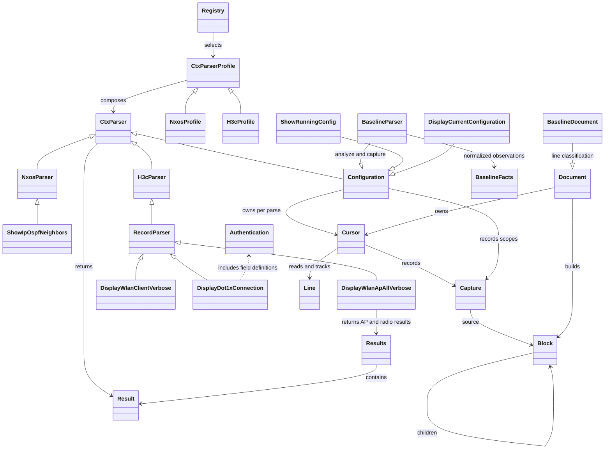

> 本文保留模块从 Motor 提取前的领域设计、覆盖范围、限制与验证记录，供兼容迁移和故障分析使用。
> 当前独立 gem 的安装、依赖、开发与发布入口以 [README-zh.md](../README-zh.md) 为准。
> 涉及 `Motor::*`、`Sync`、`Baseline::Check`、数据库、Rails、Rake 运维任务及私有实机证据的内容均属于 Motor 宿主集成，不随 gem 提供；历史验证记录不代表当前用户设备已经验证。

# 多厂商 CLI 解析基础

`CtxParser` 是独立于 Rails 的纯 Ruby 抽象。输入是 CLI 回显，输出是结构化事实和诊断。具体语法归所属业务模块维护：当前接入 Cisco N9K 的 `vxlan/cisco_nxos`、H3C 无线控制器的 `wireless/h3c`，以及多厂商配置基线 `baseline`。

## 对象职责

| 对象 | 职责 |
| --- | --- |
| `Parser` | 统一 `.parse(text, complete: false)` 接口和参数校验；具体策略实现 `parse_output` |
| `Configuration` | 持有配置文档、游标和节点，管理来源状态、捕获与嵌套路径；配置语法由具体策略处理 |
| `Cursor` | 保存原文，顺序读取、窥视、回退，独立记录访问状态和逐行解析状态 |
| `Line` | 不可变的源行，保留原始文本；构造时计算并缓存缩进和匹配文本 |
| `Block` | 配置树节点，保存父子层次、源行范围和完整配置块原文 |
| `Capture` | 已提取数据的不可变快照，将结果路径关联到来源配置块 |
| `Document` | 把通用块树与可覆写的逐行分类策略组合；设备平台声明自身边界 |
| `Input` | 按调用方选择编码、换行、NUL 和最大字节数规则 |
| `Values` | 严格转换十进制整数、MAC、主机地址和 IPv4 前缀；范围由解析器传入 |
| `Records` | 按调用方的身份键分析重复项，提供首条保留与无歧义投影 |
| `Immutable` | 复制并冻结纯数据，与调用方的可变对象隔离 |
| `Result` | 单个清单的 `status / records / issues` |
| `Results` | 以 `by_dimension` 保存同一回显的具名结果，各维度独立保留 `Result` 和完整性 |
| `Commands` | 一次声明命令、解析器与结果维度，校验并生成不可变索引 |
| `Profile` | 组合命令与解析器，按型号覆盖策略，共享命令只解析一次 |
| `Registry` | 由业务模块声明支持的平台和别名，选择对应 `Profile` |

公共库不导入具体厂商，也不维护任何命令正则、设备会话或数据库投影。业务模块按职责复用公共抽象；VXLAN、Wireless 使用命令注册表，Baseline 直接从配置文本进入 `Configuration`。

`Profile#queries(names)` 生成冻结的命令到维度计划，保留选择顺序并合并共享命令，支持同一维度的多条脚本。`parse_many` 选择覆盖全部维度的命令后直接查找解析器，型号覆盖仍优先；不重复扫描同一维度的命令列表，也不缓存可能被动态扩展替换的命令表。

`Results#by_dimension` 是不带默认值或默认回调的普通冻结 Hash。未声明维度的下标读取返回 nil，`fetch` 抛出 KeyError，不能由调用方 Hash 的默认规则伪造解析证据。
Result 的记录和诊断必须为 Hash 数组，是防御性复制后的不可变数据；通过 `with(...)` 替换，不能原地修改。文档在词法分析完成后也复制并深度冻结诊断，避免分类器保留的引用修改已有证据。

`Immutable` 接受普通 Hash、Array、String、Symbol、nil、布尔值及内建 Integer、Float、Rational、Complex。Complex 的分量须满足同一规则；不接受自定义 Numeric 对象，即使其外层已冻结。Float 的非有限值仍保留，是否允许由具体字段语义决定。

配置块的子节点必须属于同一游标、位于父范围内并按来源顺序排列，不可重复或重叠。完整性查询直接读取当前行状态，遇到未解决行立即返回；不会缓存可能过时的完整性结论。`benchmark/completeness.rb` 独立测量该查询，不代表端到端设备解析性能。
具体兼容边界见 [模块架构](https://github.com/gatework/motor/blob/main/backend/vendor/ARCHITECTURE.md)。

```text
vendor/
  ctx_parser/lib/ctx_parser/
    parser.rb
    cursor.rb
    line.rb
    block.rb
    capture.rb
    document.rb
    configuration.rb
    input.rb
    values.rb
    records.rb
    immutable.rb
    result.rb
    results.rb
    commands.rb
    profile.rb
    registry.rb
  vxlan/lib/vxlan/
    parser_registry.rb
    cisco_nxos/
      profile.rb
      parser.rb
      configuration.rb                    # 特性、模板与网段事实归约
      document.rb                         # 配置来源文档
      evpn_l2route.rb
      parsers/show_*.rb                    # 12 条 NX-OS 命令
  wireless/lib/wireless/
    parser_registry.rb
    fields.rb                           # 无线领域共用的值转换
    h3c/
      profile.rb
      parser.rb
      command_output.rb                   # 配置与运行命令共用输入边界
      configuration.rb                    # 实体身份、归属与认证类型
      document.rb                         # 配置来源文档
      record_parser.rb                    # 标签字段与记录分组
      authentication.rb                   # 认证字段与身份定义
      parsers/display_*.rb                 # 10 条 H3C 命令
  baseline/lib/baseline/
    document.rb                           # Baseline 自身的 banner 和提示行分类
    facts.rb                              # 跨命令的事实归约，不依赖解析游标
    parsers/*.rb                          # 各平台的管理基线规则
```



## 调用

安装对应 gem 后，Ruby 脚本可以直接 require 对应命令文件；模块间依赖由 RubyGems/Bundler 解析，模块内部继续使用 `require_relative`。

```ruby
require "vxlan/cisco_nxos/parsers/show_ip_ospf_neighbors"

result = Vxlan::CiscoNxos::Parsers::ShowIpOspfNeighbors.parse(cli_output, complete: true)
result.status
result.records
result.issues
```

按实际设备平台和型号选择策略：

```ruby
require "vxlan/parser_registry"
require "wireless/parser_registry"

nxos = Vxlan::ParserRegistry.fetch(:cisco_nxos, model: "N9K-C93180YC-FX")
result = nxos.parse(:ospf_neighbors, ospf_output, complete: true)

h3c = Wireless::ParserRegistry.fetch(:h3c_wireless, model: controller_model)
results = h3c.parse_many(%i[access_points radios], ap_output, complete: true)
results.fetch(:access_points).records
results.fetch(:radios).records

# 直接调用共享命令时，返回 Results。
parsed = Wireless::H3c::Parsers::DisplayWlanApAllVerbose.parse(ap_output, complete: true)
parsed.fetch(:access_points).complete?
parsed.fetch(:radios).issues
```

`h3c_wireless` 是 `h3c` 的显式别名。未知平台或维度抛出 `ArgumentError`；一份回显不能通过 `parse_many` 解释为多条不同命令。

共享回显的视图逐个投影：缺失视图返回 `failed / missing_parser_view`，投影异常返回
`failed / parser_projection_failed`，非 `Result` 返回值标记 `invalid_parser_result`；其他有效视图保留。
命令选择、输入校验和解析器执行本身的异常仍沿原调用契约抛出，由领域采集器在该命令边界隔离。
公共解析层不执行网络操作；三个领域共用的命令执行边界见 [`ctx_driver`](https://github.com/gatework/ctx_driver)。

`complete` 默认 `false`，仅在调用方确认完整接收时传 `true`。它不保证解析结果完整：未知行、计数矛盾、身份冲突或空表证据不足仍会降低状态。NX-OS 和 H3C 保留各自的编码、空表、去重和失败策略，例如 NX-OS 剔除所有冲突身份，H3C 保留首条并标记不完整。具体策略不会把未知回显当作完整空清单。

业务适配器将结果转换成原有 `Vxlan::Observation`、`Wireless::Observation`，补充维度和采集证据。LLDP 解析器只提取回显中的端点，AP 名称由无线适配器补入。配置中的秘密只保留必要的存在标记。

## 有状态的配置分析

配置策略使用同一个游标和配置块模型。`Cursor` 不包含厂商命令；`Block.read` 使用游标逐行建立缩进树，厂商策略声明注释和显式边界，再解释每个节点。块树构建与领域外子树的忽略使用显式栈，避免深层缩进耗尽 Ruby 调用栈。Cisco N9K 使用缩进及 `end`，H3C 使用缩进及 `#`、`return`。完整块包含未知子语句、空行和注释，保留 LF、CRLF、CR 和末行没有换行的原貌；显式结束行独立保留在游标中，不包含在前一个块内。

`Line#text` 返回缓存的冻结字符串，`Line#indent` 返回缓存的缩进宽度；`raw` 和 `Data` 成员仍为 `index / raw`。需要编辑匹配文本时先 `dup`，不要修改源行。缓存只属于当前文档，不跨解析调用共享。

需要追踪来源时，保留解析器实例：

```ruby
profile = Vxlan::ParserRegistry.fetch(:cisco_nxos, model: "N9K-C93180YC-FX")
parser = profile.parser_for(:configuration).new
result = parser.parse(cli_output, complete: true)

cursor = parser.cursor
cursor.position                 # 下一行的零基索引；构建块树后位于 EOF
cursor.state(0)                  # :parsed / :ignored / :unsupported / :invalid / :pending
cursor.visited?(0)               # 读过不代表解析成功
cursor.unparsed_content         # 未处理、未知或无效行的原文
parser.blocks                   # 根配置块；children 可查看嵌套上下文

capture = cursor.captures_for([:interfaces, "Vlan110"]).first
capture.data                    # 此块处理完成时的结构化数据快照
capture.line_range              # 面向用户的一基行号范围
capture.content                 # 此接口的完整原始配置，包括尚未识别的子命令
capture.complete?               # 块内每行均已解析或明确忽略；不表示传输完整
```

捕获路径相对于 `result.records.first`，可用 `result.records.first.dig(*capture.path)` 对照最终结果。H3C 的组、AP、模板、型号和 Radio 块也保留来源，例如 `[:service_templates, 0]`。同一结果可有多个来源；捕获按源文档顺序返回，各自保存处理该块时的数据，后面的配置覆盖值不会改写前面的快照。重复或冲突的配置保留原文及无效状态，捕获信息用于追踪解析过程，最终可用数据仍以 `Result` 为准。

同一次事实归约关联多条来源时，使用 `cursor.capture_many(blocks, data:, path:)`。
该调用先校验所有来源属于当前游标，再复制并深度冻结一份值与路径供各 Capture 引用；返回冻结的 Capture 数组。
调用方数据不会被修改或冻结，下一次捕获仍产生独立快照。`captures_for(path)` 使用不可变路径索引并缓存排序结果，
新增捕获或 `reset!` 会使对应缓存失效；`complete?` 仍实时读取行状态，不因来源查询缓存而过时。

游标也可独立用于新策略：

```ruby
cursor = CtxParser::Cursor.new(cli_output)
line = cursor.peek              # 不前进、不标记访问
line = cursor.read              # 前进并标记访问，语义状态仍为 :pending
cursor.mark(line.index, state: :parsed) # 仅在成功解释后标记
cursor.step_back                # 只回退位置
cursor.unread                   # 回退并把对应行恢复为 :pending
cursor.defer                    # 当前上一行恢复待解析，位置不变
cursor.rewind                   # 回到开头，保留访问、解析状态和捕获
cursor.reset!                   # 清空全部分析状态和捕获，重新开始
```

`read_pending` 从当前位置查找下一条 `:pending` 行，也不会自动标成成功。空行和注释由块构建器标为 `:ignored`；领域外配置由具体策略明确忽略，未知相关语句标为 `:unsupported`，无效值标为 `:invalid`。读取原文、解释语法和保存结构化结果因此各有明确职责。

每次 `parse` 都重新建立游标和块树，包括失败调用；前一次保留的游标不会被下一次调用改写。单个解析器实例供一次顺序分析使用，并发调用应各用一个实例，`Profile` 已按此方式创建策略。

原始配置可能含密钥。原文只通过 `cursor.content`、`line.raw`、`block.content`、`capture.content` 显式读取；这些对象及解析器的 `inspect`、`as_json` 仅输出元数据。`Capture#data` 是脱离可变结果的冻结快照。`Result#to_h` 仍只有 `status / records / issues`，现有采集与库存序列化不携带游标或原文。

## 多业务共用的纯能力

VXLAN、Wireless 和 Baseline 使用同一套输入与结构能力；各模块继续维护自己的 Profile、设备语法和业务结果规则。

```ruby
CtxParser::Input.text(raw, encoding: :utf8, newlines: :lf)
CtxParser::Values.integer("4094", min: 1, max: 4094)
CtxParser::Values.mac_address("aabb.ccdd.eeff") # => "aa:bb:cc:dd:ee:ff"

rows = CtxParser::Records.new(records, identity: [ :name ])
rows.first_occurrences
rows.unambiguous
rows.duplicate_identity_count

snapshot = CtxParser::Immutable.copy({ "facts" => [ "ssh" ] })
```

`Wireless::Fields` 继续提供无线领域的兼容入口和单位转换；通用输入边界、数字、MAC、IP 与去重委托给 `ctx_parser`。`Records` 分析身份，但不决定如何处置重复行：无线保留首条并诊断，NX-OS 剔除同身份的所有记录。Baseline 共用 `Document` 块树与不可变数据复制，banner、无效回显标记和事实规则仍由 Baseline 定义。

## 新厂商、型号和格式

`Values.integer` 只接受非负 Integer、完整十进制文本或表示缺失的 nil。`min` / `max` 仅接受 Integer 或 nil，且上限不得小于下限；即使原始值缺失，也校验选项。MAC 的四位分组格式必须一致使用点号或连字符，不混用分隔符。

新增厂商时，在所属业务模块下建立平台目录、具体命令类和 `Profile`，加入该模块的 `ParserRegistry`。无需修改公共库或其他厂商的解析代码。

每个平台通过普通 Ruby 数据声明一份 `DECLARATIONS`，命令字符串只出现一次。相同回显的多个视图放在同一条声明中：

```ruby
DECLARATIONS = CtxParser::Commands.new([
  { dimensions: %i[access_points radios], command: "display wlan ap all verbose",
    parser: Parsers::DisplayWlanApAllVerbose },
  { dimensions: [ :clients ], command: "display wlan client verbose",
    parser: Parsers::DisplayWlanClientVerbose }
])
COMMANDS = DECLARATIONS.by_dimension
PARSERS = DECLARATIONS.parsers
```

`Registry` 的平台和别名声明必须为 Hash，归一化名称冲突、不存在的别名目标及别名链均拒绝，配置错误统一在构造边界抛出 ArgumentError。

`Commands` 在构造时拒绝空声明、重复命令或维度、含控制字符的命令，以及非 `Parser` 子类。声明数据由本实例复制并持有，命令索引在构建时追加、完成后冻结，避免每次追加复制已有列表；不冻结解析器类或调用方的原始数组。`benchmark/commands.rb` 测量构建和派发成本，保留命令顺序及结果校验。由此派生的 `COMMANDS`（维度到命令）和 `PARSERS`（命令到策略）保持原有查询接口；已有自定义 Profile 仍可使用这两个映射。

具有共同语法的命令可复用平台基类；特有字段、表头、身份与总数规则留在对应命令中。会话、命令执行和证据持久化由采集器负责；`Commands` 不执行 I/O，也不引入动态类名查找或自动注册。

型号差异用平台 `Profile::MODEL_PARSERS` 声明，形状为 `{ "规范化型号" => { "命令文本" => 专用解析器类 } }`。型号键使用去除首尾空格的小写完整型号，按精确名称匹配；专用解析器可继承已有命令类，仅覆盖有差异的方法。Profile 初始化时校验并复制所选型号的覆盖表：只允许覆盖已声明命令，策略必须继承 `Parser`；修改原表不会改变已创建的 Profile。未覆盖命令和无专用策略的型号使用该平台的公共格式，未知语法仍会产生不完整结果。采集器传入现有 `Motor::Device#model`，AP LLDP 使用 AP 自身型号。

当前 N9K 和 H3C 无线控制器使用仓库已有回显样本的格式。新增型号或固件差异规则，需要脱敏样本及完整、截断、未知字段回归。型号覆盖机制已用测试策略验证，生产映射中没有虚构的型号或固件规则。

## 验证

```sh
RAILS_ENV=test bundle exec rspec spec/vendor/ctx_parser spec/vendor/vxlan spec/vendor/wireless spec/vendor/baseline
RAILS_ENV=test bundle exec rails zeitwerk:check
bundle exec rubocop vendor/ctx_parser vendor/vxlan vendor/wireless vendor/baseline
```

测试包含无 Rails 的独立加载、型号选择、共享回显解析、输入完整性、旧接口兼容、替身会话和测试数据库投影。真实设备联调另行验证。

纯 Ruby 性能样本覆盖 10,000 个合成接口块（20,001 行）、1,000 条同事实来源及1,000个路径查询。
分别报告耗时和分配对象数，每次验证事实输出、来源顺序及值快照。构造输入不计入耗时；
比较不同实现时使用相同 Ruby、脚本与空闲环境，通过 `-I` 选择对应版本的 `baseline/lib`：

```sh
bundle exec ruby -I vendor/baseline/lib vendor/ctx_parser/benchmark/configuration.rb
```

该样本用于观察公共配置树与行匹配的成本，不代表设备采集、数据库同步或真实网络吞吐。
